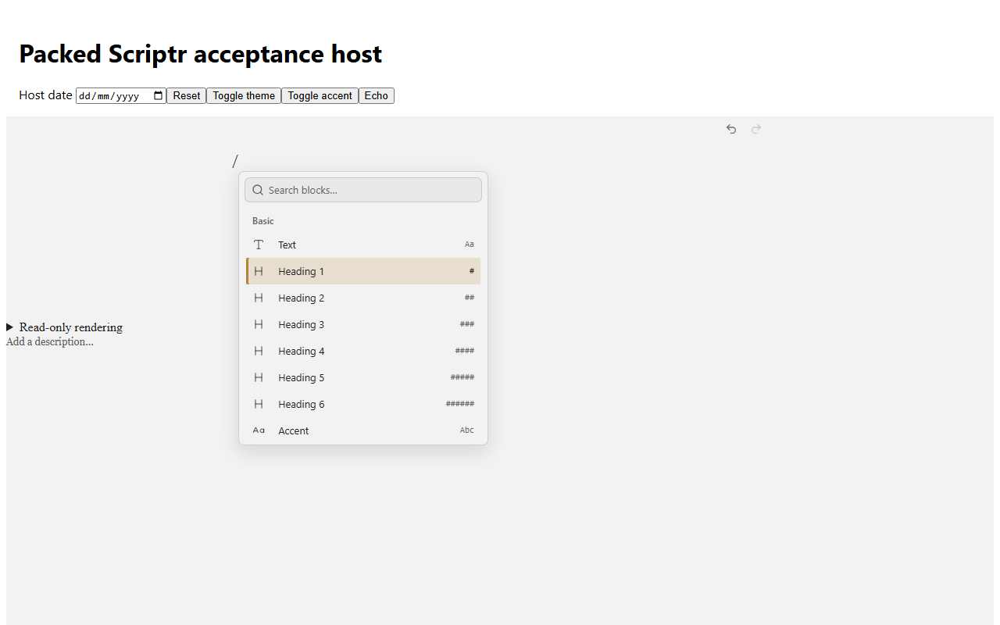
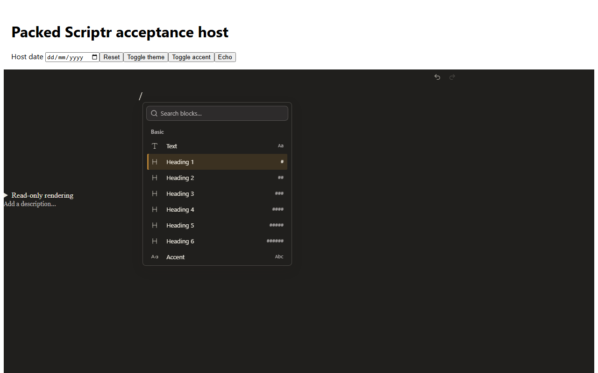
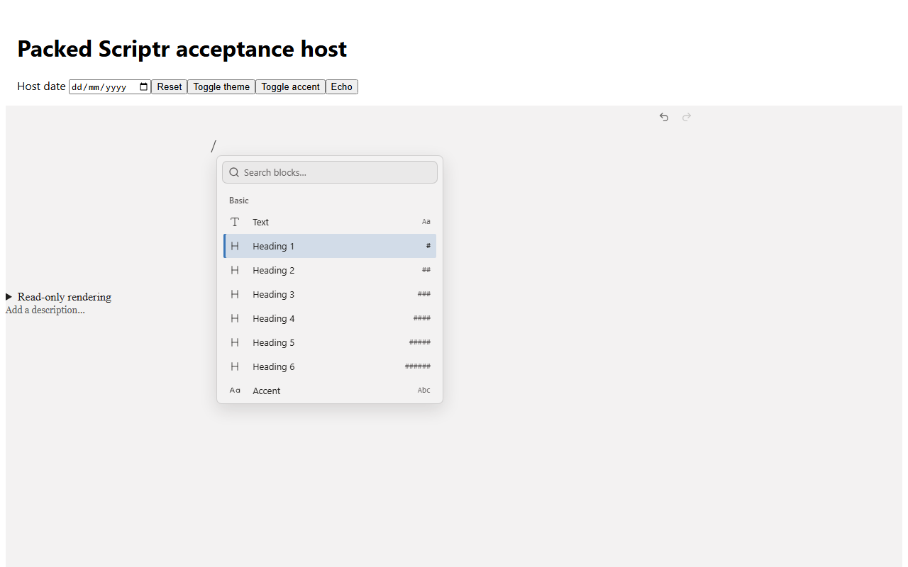
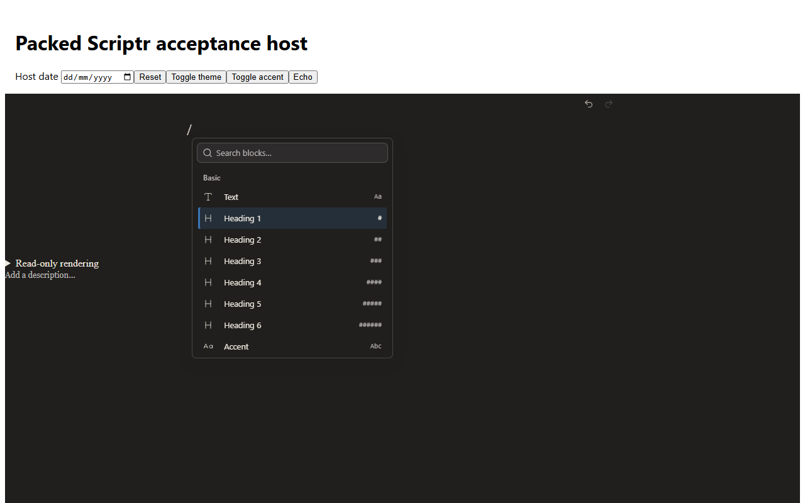
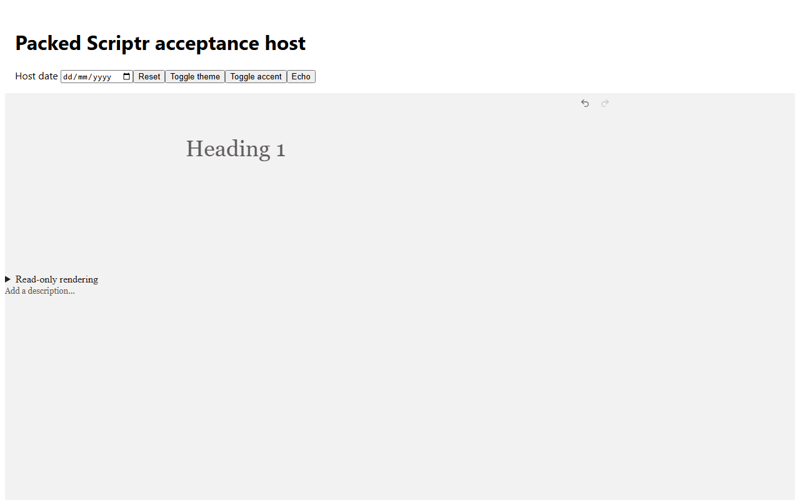
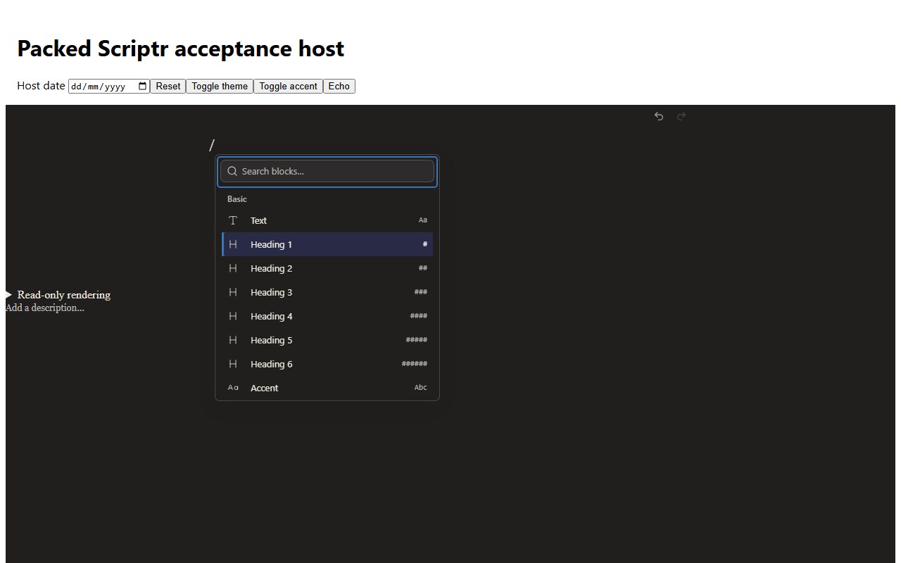
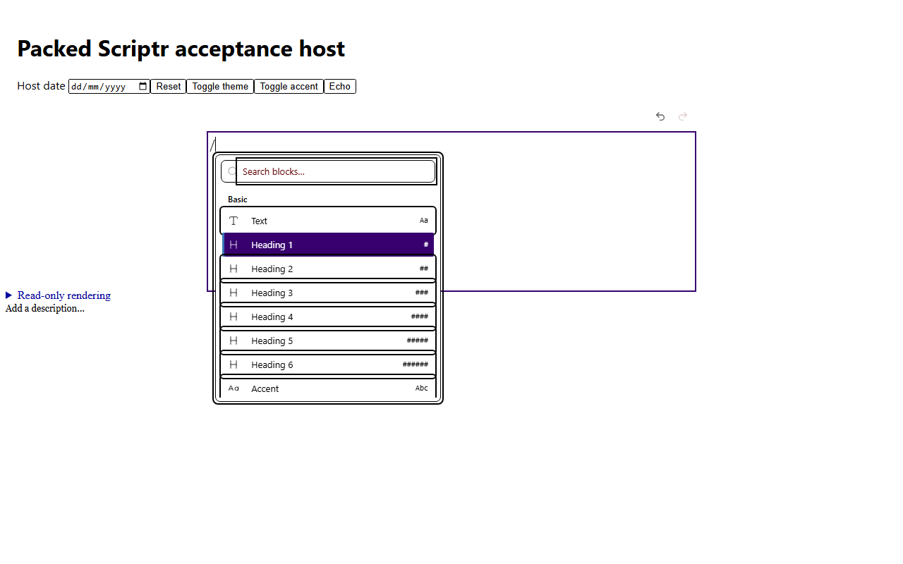
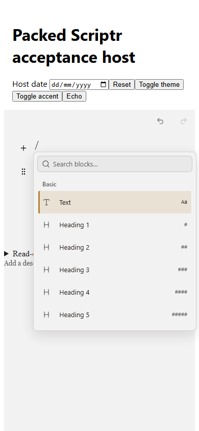

# Scriptr Editor 0.2.1

6 November 2026. Consumer baseline: 0.2.0.

- Fixed slash-menu state selectors that treated `data-selected="false"` as selected. Normal, hover and keyboard-active states now have coherent accent styling, legible text and icons, 140 ms colour transitions, visible focus, reduced-motion and forced-colors treatment.
- Styled the standalone search input and enabled direct input filtering, with a placeholder-independent accessible name. Portals receive theme and the optional typed `PresentationConfiguration.accentColour`. UI typography stays independent of document fonts.
- Added Heading 1–6, code-block and toggle-title ghost text. The paragraph prompt remains configurable. Ghost text is absent from canonical content, clipboard/serialization and read-only output, ignores pointer events, and uses an empty accessibility alternative. All six heading levels are available in the slash catalogue. References retain their description prompt and do not support heading commands.
- Added engine-owned word undo groups with trailing whitespace attached to the preceding word and a 500 ms idle boundary. Paste, selection replacement, formatting, block conversion, paragraph breaks, deliberate caret movement and deletion-direction changes separate typing. Unicode graphemes and composition updates are grouped safely. Scripts without spaces group until idle, a composition boundary or another action.
- Equivalent controlled echoes preserve selection, undo, redo and provenance. Genuine external replacement clears both history branches and provenance checkpoints, excludes reconciliation from authored history, and cannot resurrect stale content through undo. Existing contribution identifiers survive undo/redo; external uncertainty retains the existing `unresolved` contract.
- Scoped native scrollbar, focus, selection and theme defaults to package-owned surfaces and portals. Host native controls retain their styling.
- Updated Zod to 4.6.6 and workspace Next/Vite to their audited patched versions. Canonical Document v2, migrations, provider boundaries and package entry points are unchanged.

Import `@startupmedia/scriptr-editor/styles.css` once. No Tailwind scanning or new configuration is required. An alternate accent may be supplied with `<ScriptrPresentationProvider configuration={{ accentColour: '#3976b8' }}>`. No application dependency was changed.

## Verification

`pnpm check` passed: formatting, lint, strict typechecks, all tests, production
builds, emitted-file budgets, packed exports/types/React 18 and 19 SSR consumers,
and dependency licenses. `pnpm audit --prod` reported no known vulnerabilities.
The separate `pnpm package:browser-check` passed all 40 assertions.

The focused tests reproduced the original placeholder, uninterrupted typing and external-history replacement failures before their fixes. Real browser testing additionally found coalesced caret movement and metadata-only transactions incorrectly separating selection replacements; both have engine regression coverage.

`pnpm package:browser-check` packs and installs the npm artifact in an isolated minimal host importing only the documented package stylesheet. Chromium 158.0.8127.18 passed 40 browser assertions using timed keyboard events, including uninterrupted input, idle pauses, selection, movement, paste, formatting, Enter, block conversion, deletion direction, repeated undo/redo, new input after undo, emoji/combining sequences, simulated IME, controlled echoes/replacements, provenance, toolbar commands, Reference editing and all six headings. It also checks pointer/keyboard state continuity, direct search filtering, Enter, Escape, light/dark themes, two accents, actual reduced-motion/forced-colors emulation and a 390 px touch context with 44 px rows. There were no page errors.

Measured WCAG contrast ratios use computed browser colours, ancestor backgrounds and opacity; every measured normal-size text/icon state exceeds 4.5:1:

| Theme and accent | Normal text/icons | Active text/icons | Disabled text/icons | Search placeholder/icon | Muted shortcut |
| ---------------- | ----------------: | ----------------: | ------------------: | ----------------------: | -------------: |
| Light, brown     |             14.74 |             12.38 |                5.83 |                    5.38 |           5.83 |
| Light, blue      |             14.74 |             11.88 |                5.83 |                    5.38 |           5.83 |
| Dark, brown      |             13.61 |             10.54 |                8.20 |                    7.01 |           8.20 |
| Dark, blue       |             13.61 |             11.27 |                8.20 |                    7.01 |           8.20 |

The browser runner writes detailed assertions, canonical snapshots, selection, history availability, key timings, provenance, contrast measurements and screenshots to ignored `.local/release-evidence/`. The Release workflow repeats the check and uploads its evidence before publication.

Reproduce with `pnpm exec playwright install chromium` and `pnpm package:browser-check`. Run the full `pnpm check` gate and `pnpm audit --prod` before release. These checks include packed ESM/type/SSR consumers with React 18.3.1 and 19.3.0; browser acceptance uses React 19.1.1 on Windows. The npm workflow repeats validation on Linux/Node 22.

Native OS IMEs, physical touch, live screen readers, and Firefox/WebKit are not certified by these results. Composition coverage combines browser DOM composition events with engine tests of intermediate composition updates. The Scriptr application integration is a separate follow-up. The application repository's undo research file was not available in this checkout; the controlled-replacement issue was independently reproduced here.

## Screenshots

